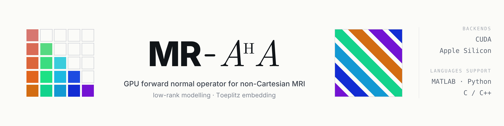

<p align="center">
  <picture>
    <source media="(prefers-color-scheme: dark)" srcset="assets/banner/dark/concept-c-square.png">
    
  </picture>
</p>

# MR_AHA

MR_AHA evaluates the forward normal operator $A^H A$ on the GPU for **non-Cartesian MRI with
low-rank (subspace / MR-Multitasking) modelling**. It uses a Toeplitz embedding, so one
application costs two FFTs per coil instead of two NUFFTs; a NUFFT-based operator with the same
interface is included as the reference.

One C++ library does the numerics for **MATLAB, Python and C/C++**. It builds for **CUDA**
(NVIDIA, one or several GPUs) or **Metal** (Apple silicon).

**Documentation: <https://mikecjz.github.io/MR_AHA_docs/>** (conventions, array shapes, masking,
multi-GPU, Apple silicon, API reference, benchmark results).

## Install

Requirements for the CUDA backend: CUDA toolkit 11.x or 12.x, CMake ≥ 3.24 and a C++17 compiler.
FINUFFT is bundled as a submodule.

```bash
git clone --recurse-submodules https://github.com/mikecjz/MR_AHA.git
cd MR_AHA

cmake -S . -B build -DCMAKE_BUILD_TYPE=Release \
      -DMR_AHA_BUILD_PYTHON=ON \
      -DMR_AHA_BUILD_MATLAB=ON      # needs MATLAB_ROOT; leave out if you do not use MATLAB
cmake --build build -j
```

* **Python:** `pip install -e python`, then `pip install cupy-cuda12x` (match your CUDA toolkit).
* **MATLAB:** add `matlab/` and `build/matlab/` to the MATLAB path.
* **Apple silicon:** the same CMake commands select the Metal backend on macOS. The extra
  requirements are listed in the
  [Apple silicon guide](https://mikecjz.github.io/MR_AHA_docs/guide/apple-silicon.html).

All build options are described in the
[installation guide](https://mikecjz.github.io/MR_AHA_docs/getting-started/install.html).

## Quick start

Create the operator once from the sensitivity maps `SEs`, the Gram blocks `phi2` and the
trajectory `traj`, then apply it as often as needed, for example inside conjugate gradient.

Python (CuPy arrays; NumPy arrays on Apple silicon):

```python
import mr_aha

cfg = mr_aha.make_config("stack", (320, 320, 56), L=16, n_coils=12)

with mr_aha.create_op(cfg, SEs, phi2, traj) as op:   # Toeplitz kernel computed here
    for _ in range(n_iter):
        AhAx = op(x)
```

MATLAB (`gpuArray` inputs; ordinary arrays on Apple silicon):

```matlab
config = mr_default_config('stack', [320 320 56], 16);

op = mr_aha.create_op(SEs, phi2, traj, config);   % Toeplitz kernel computed here
for it = 1:n_iter
    AhAx = op * x;
end
delete(op);                                          % frees the GPU memory
```

`method="nufft"` selects the NUFFT operator and `devices="all"` uses every visible GPU. Array
shapes, the Gram-block convention and the C API are in the
[documentation](https://mikecjz.github.io/MR_AHA_docs/).

## Related repositories

* [MR_AHA_docs](https://github.com/mikecjz/MR_AHA_docs): sources of the documentation website.
* [MR_AHA_benchmarks](https://github.com/mikecjz/MR_AHA_benchmarks): Python and MATLAB scripts
  that time the Toeplitz and NUFFT operators on one or several GPUs.

Contributions are welcome; see [CONTRIBUTING](.github/CONTRIBUTING.md).

## License

mr_aha is dual-licensed:

* **[GNU AGPL v3 only](LICENSE)**, free for any use, including commercial, provided that works
  built on it that are distributed or offered as a network service release their full source
  under the AGPL. An additional permission allows linking with CUDA and MATLAB.
* **Commercial license** for closed-source products or services. Contact
  <junzhou@chen.engineer>.

See [`licenses/LICENSING.md`](licenses/LICENSING.md) for details, examples, third-party licenses and the
contributor license agreement.
