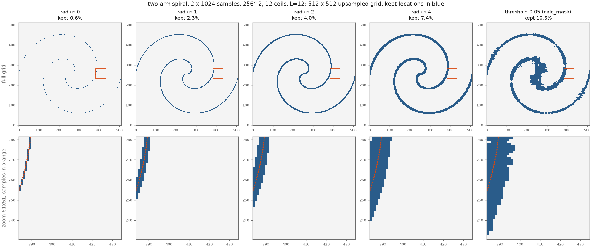
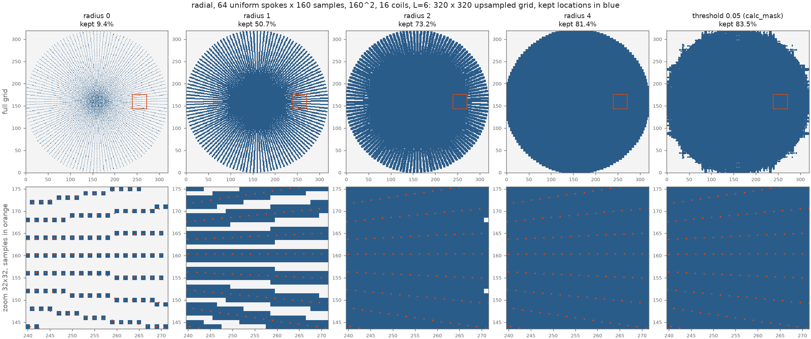
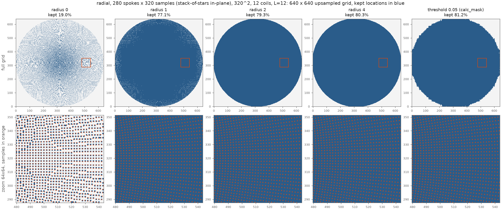
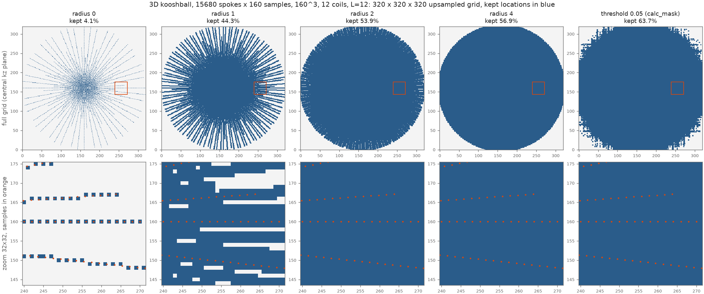

# Neighbourhood mask vs. kernel-threshold mask

This report tests a simpler way to build the k-space mask of the masked Toeplitz operator: keep only
the grid locations close to the samples. It measures how much of the upsampled grid each mask keeps
and how accurate the masked operator is. CG convergence is not tested; only single-operator accuracy
is. The code is [`neighbour_mask.py`](neighbour_mask.py). Raw numbers are in
`results/pact400-recon3/neighbour_mask_<problem>.json`, measured on a TITAN RTX.

> **Outcome.** The neighbourhood mask with r = 2 is now the library default
> (`mask_method = 'neighbour'`, `mask_radius = 2`). The kernel threshold remains available as
> `mask_method = 'threshold'`. The library implementation gives masks bit-identical to the CuPy
> reference used here. It was also checked on the full 377-spoke 2D radial data (160², not one of
> the four problems below), where the threshold mask is the more accurate of the two:
>
> | 377-spoke radial, 160² | r = 1 | r = 2 (default) | r = 3 | r = 4 | r = 6 | r = 8 | threshold 0.05 |
> |---|---|---|---|---|---|---|---|
> | grid kept | 79.2 % | 80.3 % | 81.3 % | 82.3 % | 84.2 % | 85.8 % | 83.1 % |
> | image error ÷ out | 9.5·10⁻⁵ | 5.3·10⁻⁵ | 3.8·10⁻⁵ | 2.1·10⁻⁵ | 1.2·10⁻⁵ | 5.9·10⁻⁶ | 4.3·10⁻⁶ |
> | white-noise error ÷ out | 6.9·10⁻³ | 4.2·10⁻³ | 2.8·10⁻³ | 2.0·10⁻³ | 1.2·10⁻³ | 7.6·10⁻⁴ | 8.4·10⁻⁴ |

## Summary

The table compares the two masks at about the same grid size, using the operator error on the image
input (÷ out). The radius column gives the smallest neighbourhood radius that matches the default
threshold's accuracy.

| problem | threshold 0.05 (default): kept / error | neighbourhood, same accuracy: radius / kept | neighbourhood at the same size: kept / error | unmasked error (floor) |
|---|---|---|---|---|
| 2-arm spiral | 10.6 % / 1.0·10⁻³ | not reached by r = 8 (14.2 %, 3.1·10⁻³) | r = 6: 10.8 % / 8.0·10⁻³ | 5.2·10⁻⁷ |
| 64-spoke radial | 83.5 % / 4.2·10⁻⁵ | r = 6 / 83.3 % | r = 6: 83.3 % / 4.0·10⁻⁵ | 1.0·10⁻⁶ |
| 280-spoke radial | 81.2 % / 1.6·10⁻⁶ | r = 6 / 81.4 % (r = 2: 79.3 %, 3.3·10⁻⁶) | r = 6: 81.4 % / 1.6·10⁻⁶ | 1.2·10⁻⁶ |
| 15680-spoke kooshball | 63.7 % / 4.0·10⁻⁶ | **r = 2 / 53.9 %** | r = 8: 62.8 % / 4.0·10⁻⁶ | ≈ 3.8·10⁻⁶ ¹ |

¹ The unmasked 3D kernel does not fit next to the test data on the 24 GB TITAN RTX. The value given
is the unmasked Toeplitz-vs-NUFFT difference measured on the L40S in [README.md](README.md).

* **Dense trajectories (64 and 280 radial spokes, kooshball): the neighbourhood mask is as good or
  better.** For the two radial problems, a radius chosen to keep the same fraction of the grid
  gives the same error as the threshold mask. In 3D it is better: r = 2 keeps **53.9 %** of the grid
  instead of 63.7 % at the same 4·10⁻⁶ error, already at the Toeplitz floor. That frees about 10 %
  of the grid, or about 2 GB of kernel at L = 12. 53.9 % is close to the volume of the sampled
  sphere, π/6 = 52.4 % of the cube. The threshold mask also keeps the streaks of kernel tail
  outside the sphere, which matter little for dense sampling.
* **Sparse trajectory (two-arm spiral): the threshold mask is better.** At the same size (about
  11 % kept) the threshold mask's error is 8× smaller (1.0·10⁻³ vs 8.0·10⁻³). The neighbourhood
  error falls slowly with radius: r = 8 still gives 3·10⁻³ at 14 % kept. Here the kernel's energy
  away from the arms lies in tails that run parallel to the kx and ky axes (see
  [the earlier spiral plot](results/pact400-recon3/spiral_mask_N256.png)). A box around each sample
  does not follow those tails; the thresholded kernel does.
* **r = 0 (nearest grid point only) is never usable.** Its error is about 10⁻¹ in every problem.
  Samples fall between grid points, so the kernel around a sample is spread over at least the
  neighbouring cells. For radial and kooshball sampling, r = 1 already leaves gaps between spokes
  near the edge of k-space.
* **White noise** is harder for both masks, because it puts energy at frequencies that the mask
  drops. At the same kept fraction the two masks give similar noise errors in every problem except
  the 3D one, where r = 6 (59.9 %) gives 6.7·10⁻⁴ against 7.3·10⁻⁴ for the threshold (63.7 %).

**Recommendation.** For dense radial and 3D trajectories, a neighbourhood mask with r = 2–4 is a
cheap alternative and saves extra memory in 3D. Its cost is a single scatter and a max-filter, with
no NUFFT. For sparse trajectories such as few-arm spirals, keep the kernel-threshold mask. Neither
mask reaches 10⁻⁵-level accuracy on the spiral while keeping a small share of the grid.

## The two masks

**Neighbourhood mask, radius r (new).**

1. Map every sample k (in radians) to its nearest point on the upsampled M = 2N grid:
   `round(k·M/2π) + M/2`, modulo M.
2. Mark those points.
3. Dilate the marks with a (2r+1)ᵈ box, so that every point within r cells of a marked point is kept
   (Chebyshev distance, periodic edges).

r = 0 keeps only the nearest grid point of each sample. Note that on the 2× grid, samples along a
radial spoke are 2 cells apart.

**Threshold mask (`calc_mask`, current).** Compute the trajectory's unit-weight Toeplitz kernel |T|,
apply a 3ᵈ max-filter, and keep the points above an absolute threshold. The default threshold is
0.05; 0.01 and 0.003 are shown for reference.

## Test problems

| problem | trajectory | matrix | coils | L | input image |
|---|---|---|---|---|---|
| spiral | 2-arm Archimedean spiral, 2 × 1024 samples, 1 revolution ([`make_spiral.py`](make_spiral.py)) | 256² | 12 | 12 | synthetic ellipses; synthetic coils and rank-3 Gram blocks |
| radial64 | 64 spokes × 160 samples, every 377/64-th spoke of `data/human_C-35_2D_radial.mat` (uniform over 180°) | 160² | 16 | 6 | stored coefficients `x` |
| radial280 | 280 spokes × 320 samples, the in-plane trajectory of `data/AhAx_test_toeplitz.mat` | 320² | 12 | 12 | middle slice of `Ahb`, with the kz = 0 Gram blocks and middle-slice coils |
| kooshball | 15680 spokes × 160 samples, synthetic ([`make_kooshball.py`](make_kooshball.py)) | 160³ | 12 | 12 | `x_true` |

radial280 is run as a single 2D plane. A stack-of-stars mask is this in-plane mask repeated over kz,
so its kept fraction is the same.

## Error measures

Each masked Toeplitz $A^HA$ is compared with the NUFFT $A^HA$ (cufinufft, eps 10⁻⁶) on two
inputs: the image above and complex white noise. The noise input is the worst case, because it puts
equal energy at every spatial frequency. Each error is normalised in two ways:

* **÷ out:** $\|T_\text{mask}x - A^HAx\| / \|A^HAx\|$, relative to the operator's output;
* **÷ in:** $\|T_\text{mask}x - A^HAx\| / (\|A^HA\|\,\|x\|)$, relative to the input times the
  operator norm, which is estimated by power iteration. Unlike ÷ out, this is not inflated when the
  operator itself makes the input small, as it does for sparse trajectories.

The "unmasked" row is the floor: the Toeplitz embedding error plus the NUFFT tolerance.

## Results per problem

Each figure shows the mask at radii 0, 1, 2 and 4 and the default threshold mask. The top row is
the full upsampled grid (for 3D, the central kz plane). The bottom row zooms in on the orange box,
at about 60 % of k_max along +kx, with the samples in orange; for 3D only samples within half a
cell of that plane are shown. Kept locations are blue.

### Two-arm spiral (256², 512² grid)



| mask | grid kept | image ÷ out | image ÷ in | white noise ÷ out | white noise ÷ in |
|---|---|---|---|---|---|
| neighbourhood r = 0 | 0.6% | 1.3·10⁻¹ | 1.4·10⁻² | 1.8·10⁻¹ | 1.8·10⁻³ |
| neighbourhood r = 1 | 2.3% | 4.3·10⁻² | 4.5·10⁻³ | 6.0·10⁻² | 6.2·10⁻⁴ |
| neighbourhood r = 2 | 4.0% | 2.9·10⁻² | 3.1·10⁻³ | 3.9·10⁻² | 4.0·10⁻⁴ |
| neighbourhood r = 3 | 5.7% | 1.9·10⁻² | 2.0·10⁻³ | 2.6·10⁻² | 2.7·10⁻⁴ |
| neighbourhood r = 4 | 7.4% | 1.6·10⁻² | 1.6·10⁻³ | 2.0·10⁻² | 2.0·10⁻⁴ |
| neighbourhood r = 6 | 10.8% | 8.0·10⁻³ | 8.4·10⁻⁴ | 1.4·10⁻² | 1.4·10⁻⁴ |
| neighbourhood r = 8 | 14.2% | 3.1·10⁻³ | 3.3·10⁻⁴ | 9.9·10⁻³ | 1.0·10⁻⁴ |
| threshold 0.05 (default) | 10.6% | 1.0·10⁻³ | 1.1·10⁻⁴ | 9.8·10⁻³ | 1.0·10⁻⁴ |
| threshold 0.01 | 50.0% | 1.0·10⁻⁴ | 1.0·10⁻⁵ | 2.5·10⁻³ | 2.6·10⁻⁵ |
| threshold 0.003 | 83.3% | 4.6·10⁻⁶ | 4.8·10⁻⁷ | 3.3·10⁻⁴ | 3.4·10⁻⁶ |
| unmasked | 100.0% | 5.2·10⁻⁷ | 5.4·10⁻⁸ | 4.8·10⁻⁷ | 5.0·10⁻⁹ |

### 64-spoke radial (160², 320² grid)



| mask | grid kept | image ÷ out | image ÷ in | white noise ÷ out | white noise ÷ in |
|---|---|---|---|---|---|
| neighbourhood r = 0 | 9.4% | 1.4·10⁻¹ | 1.1·10⁻² | 2.8·10⁻¹ | 4.9·10⁻³ |
| neighbourhood r = 1 | 50.7% | 2.6·10⁻³ | 2.1·10⁻⁴ | 7.9·10⁻² | 1.4·10⁻³ |
| neighbourhood r = 2 | 73.2% | 5.3·10⁻⁴ | 4.3·10⁻⁵ | 3.2·10⁻² | 5.6·10⁻⁴ |
| neighbourhood r = 3 | 80.2% | 1.4·10⁻⁴ | 1.1·10⁻⁵ | 1.0·10⁻² | 1.8·10⁻⁴ |
| neighbourhood r = 4 | 81.4% | 6.9·10⁻⁵ | 5.6·10⁻⁶ | 7.4·10⁻³ | 1.3·10⁻⁴ |
| neighbourhood r = 6 | 83.3% | 4.0·10⁻⁵ | 3.2·10⁻⁶ | 5.1·10⁻³ | 9.0·10⁻⁵ |
| neighbourhood r = 8 | 85.0% | 3.2·10⁻⁵ | 2.6·10⁻⁶ | 4.2·10⁻³ | 7.5·10⁻⁵ |
| threshold 0.05 (default) | 83.5% | 4.2·10⁻⁵ | 3.4·10⁻⁶ | 4.5·10⁻³ | 7.9·10⁻⁵ |
| threshold 0.01 | 98.2% | 5.5·10⁻⁶ | 4.5·10⁻⁷ | 7.5·10⁻⁴ | 1.3·10⁻⁵ |
| threshold 0.003 | 100.0% | 1.1·10⁻⁶ | 8.9·10⁻⁸ | 4.0·10⁻⁵ | 7.0·10⁻⁷ |
| unmasked | 100.0% | 1.0·10⁻⁶ | 8.4·10⁻⁸ | 1.5·10⁻⁶ | 2.6·10⁻⁸ |

### 280-spoke radial (320², 640² grid)



| mask | grid kept | image ÷ out | image ÷ in | white noise ÷ out | white noise ÷ in |
|---|---|---|---|---|---|
| neighbourhood r = 0 | 19.0% | 1.2·10⁻¹ | 2.5·10⁻² | 3.2·10⁻¹ | 2.4·10⁻³ |
| neighbourhood r = 1 | 77.1% | 2.6·10⁻⁵ | 5.6·10⁻⁶ | 4.2·10⁻² | 3.2·10⁻⁴ |
| neighbourhood r = 2 | 79.3% | 3.3·10⁻⁶ | 7.0·10⁻⁷ | 7.7·10⁻³ | 5.9·10⁻⁵ |
| neighbourhood r = 3 | 79.8% | 2.3·10⁻⁶ | 4.9·10⁻⁷ | 5.6·10⁻³ | 4.3·10⁻⁵ |
| neighbourhood r = 4 | 80.3% | 2.0·10⁻⁶ | 4.3·10⁻⁷ | 4.5·10⁻³ | 3.5·10⁻⁵ |
| neighbourhood r = 6 | 81.4% | 1.6·10⁻⁶ | 3.5·10⁻⁷ | 3.4·10⁻³ | 2.6·10⁻⁵ |
| neighbourhood r = 8 | 82.3% | 1.5·10⁻⁶ | 3.2·10⁻⁷ | 2.8·10⁻³ | 2.2·10⁻⁵ |
| threshold 0.05 (default) | 81.2% | 1.6·10⁻⁶ | 3.4·10⁻⁷ | 3.2·10⁻³ | 2.5·10⁻⁵ |
| threshold 0.01 | 93.6% | 1.3·10⁻⁶ | 2.7·10⁻⁷ | 1.7·10⁻³ | 1.3·10⁻⁵ |
| threshold 0.003 | 99.5% | 1.2·10⁻⁶ | 2.5·10⁻⁷ | 3.8·10⁻⁴ | 2.9·10⁻⁶ |
| unmasked | 100.0% | 1.2·10⁻⁶ | 2.5·10⁻⁷ | 1.5·10⁻⁶ | 1.2·10⁻⁸ |

### 15680-spoke kooshball (160³, 320³ grid)



| mask | grid kept | image ÷ out | image ÷ in | white noise ÷ out | white noise ÷ in |
|---|---|---|---|---|---|
| neighbourhood r = 0 | 4.1% | 1.2·10⁻¹ | 2.7·10⁻² | 1.6·10⁻¹ | 1.2·10⁻⁴ |
| neighbourhood r = 1 | 44.3% | 2.0·10⁻⁵ | 4.4·10⁻⁶ | 1.5·10⁻² | 1.1·10⁻⁵ |
| neighbourhood r = 2 | 53.9% | 4.3·10⁻⁶ | 9.5·10⁻⁷ | 1.5·10⁻³ | 1.1·10⁻⁶ |
| neighbourhood r = 3 | 55.5% | 4.1·10⁻⁶ | 9.1·10⁻⁷ | 1.1·10⁻³ | 8.1·10⁻⁷ |
| neighbourhood r = 4 | 56.9% | 4.1·10⁻⁶ | 8.9·10⁻⁷ | 8.8·10⁻⁴ | 6.6·10⁻⁷ |
| neighbourhood r = 6 | 59.9% | 4.0·10⁻⁶ | 8.8·10⁻⁷ | 6.7·10⁻⁴ | 5.0·10⁻⁷ |
| neighbourhood r = 8 | 62.8% | 4.0·10⁻⁶ | 8.7·10⁻⁷ | 5.4·10⁻⁴ | 4.1·10⁻⁷ |
| threshold 0.05 (default) | 63.7% | 4.0·10⁻⁶ | 8.8·10⁻⁷ | 7.3·10⁻⁴ | 5.5·10⁻⁷ |
| threshold 0.01 | 91.7% | did not fit in 24 GB | | | |
| threshold 0.003 | 94.5% | did not fit in 24 GB | | | |
| unmasked | 100.0% | did not fit in 24 GB | | | |

## Reproducing

```bash
python benchmarks/make_spiral.py -o benchmarks/data/spiral_trajectory.mat   # needs mri-nufft
python benchmarks/make_kooshball.py
python benchmarks/neighbour_mask.py spiral radial64 radial280 kooshball
```
